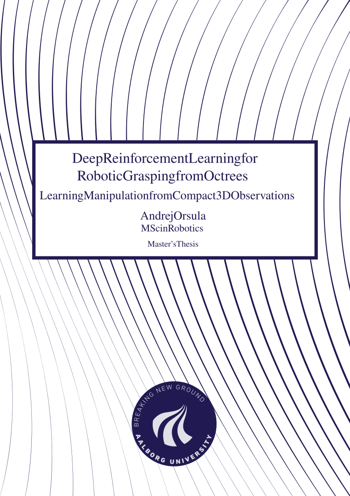

# [Master's Thesis - Deep Reinforcement Learning for Robotic Grasping from Octrees](https://andrejorsula.github.io/msc_thesis)

This repository contains LaTeX setup for my Master's Thesis conducted at Aalborg University, Denmark. If you are interested in the source code, please see [AndrejOrsula/drl_grasping](https://github.com/AndrejOrsula/drl_grasping).

Compiled PDF: [**digital edition**](https://andrejorsula.github.io/msc_thesis/msc_thesis_AndrejOrsula.pdf) (images at 300 dpi) or [**full resolution**](./master_thesis.pdf) (as submitted)

<a href="./master_thesis.pdf">
    
</a>

Accompanying recordings can be viewed under [YouTube playlist](https://youtube.com/playlist?list=PLzcIGFRbGF3Qr4XSzAjNwOMPaeDn5J6i1). Data acquired during experimental evaluation can be found inside [experimental_evaluation directory](./experimental_evaluation).

## Citation

```bibtex
@mastersthesis{orsula2021deep,
  title  = {{Deep Reinforcement Learning for Robotic Grasping from Octrees}},
  author = {Orsula, Andrej},
  type   = {Master's Thesis},
  school = {Aalborg University},
  year   = {2021},
}
```

## Website

[CI](.github/workflows/ci.yml) publishes the thesis to <https://andrejorsula.github.io/msc_thesis>. It downsamples the images of the submitted `master_thesis.pdf` with the tools of the [template submodule](https://github.com/AndrejOrsula/earthrise_thesis_template) and verifies the result against the original. To build the site locally with [uv](https://docs.astral.sh/uv):

```bash
git submodule update --init
uv run --no-project --script utils/site.py dist --revision "$(git rev-parse HEAD)"
```

## Disclaimer (LaTeX Template)

Parts of frontmatter are adapted from [jkjaer/aauLatexTemplates](https://github.com/jkjaer/aauLatexTemplates) and modified for use with `memoir` class.
